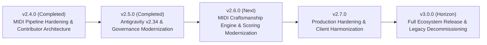

# Powercord Architecture & Governance Roadmap

This document outlines upcoming architectural horizons, modernization goals, and sovereign governance initiatives for the Powercord ecosystem. Historical details of completed milestones and ratchet graduations are maintained in [`CHANGELOG.md`](CHANGELOG.md).

---

## 1. Architectural Modularity & Anti-God-File Safety Rail

Powercord follows **Ousterhout Deep Modules** (rich behavior behind clean public seams with a `~500 LOC` soft internal decomposition trigger in `.agents/overrides/architecture-review.md`), backed by a hard **1,000-LOC anti-god-file safety rail** (`test_1000_loc_anti_god_file_safety_rail`).

* **Status**: **100% Graduated (Zero Architectural Debt — `governance_ratchet.json` retired in v2.5.0)**
* **Policy**: All modules across `powercord/app`, `powercord-client`, and `powercord-extensions/*` must remain strictly under the 1,000-LOC hard ceiling (with `~500 LOC` as the soft decomposition trigger during review), verified hermetically by `just check`.

---

## 2. Upcoming Milestones

### Milestone v2.6.0: MIDI Craftsmanship Engine & Objective Scoring Modernization
* **Focus**: Transitioning from legacy heuristic track-counting to an objective, multi-pillar MIDI Craftsmanship Index (MCI) that measures technical integrity and arrangement fidelity without artistic or genre bias.
* **Key Initiatives**:
  1. **Terminology Transparency & User-Facing Definition**:
     - Replace ambiguous "Quality Score" with "MIDI Craftsmanship Index" (MCI) across Discord embed footers, UI cards, and REST API schemas.
     - Provide contextual breakdowns (velocity dynamic range, arrangement polyphony, sequencing cleanliness) in tooltips and detail modals.
  2. **Heuristic Hardening & Solo Instrument Fairness**:
     - Eliminate the "Chopin Paradox": award arrangement complexity/diversity points when a single instrument exhibits multi-register polyphony (>3 simultaneous voices and >3 octave pitch span), ensuring solo piano, classical guitar, and minimalist arrangements are not penalized.
     - Remove arbitrary `drum_penalty` thresholds to properly accommodate rhythm-driven genres (electronic, hip-hop, funk) when intentional musical structure is present.
     - Refine duplicate note detection from coarse 10ms timestamp rounding to exact-tick or sub-5ms delta checks to prevent misidentifying fast trills, strums, and flams.
  3. **3-Pillar MIDI Craftsmanship Index (MCI)**:
     - Implement the 3-pillar scoring engine in `midiscribe.py` evaluating:
       - **Pillar 1: Technical Integrity & Hygiene (35 pts)**: Zero-duration ghost notes (<15ms), hanging notes (>180s), stuck overlapping polyphony, pitch range sanity, and tick-exact deduplication.
       - **Pillar 2: Dynamic & Human Expression (30 pts)**: Velocity variance (standard deviation measuring human dynamics vs flat robotic export), tempo map changes (`set_tempo`), and MIDI CC/articulation automation (pitch bend, mod wheel, sustain pedal CC64).
       - **Pillar 3: Arrangement Fidelity & Functional Polyphony (35 pts)**: Register-based role detection (bass register <48, chordal body 48–72, melodic contour >72, percussion).
     - Provide a library-wide re-scoring CLI tool with before/after distribution analytics in the health dashboard.

---

### Milestone v2.7.0: Production Hardening & Client Harmonization
* **Focus**: Solidifying downstream production workflows, desktop client integration, and continuous repository hygiene.
* **Key Initiatives**:
  1. **Downstream Production Synchronization**: Validate production Cloud Build submission exclusively from locked downstream assembly (`inv-downstream-deploy-origin`) with pre-deploy QA gating (`inv-pre-deploy-qa-and-backup-gate`).
  2. **Desktop Companion Client Harmonization**: Refine async RPC and REST integration between `powercord-client` (Flet) and the server framework, enforcing strict client-server decoupling (`inv-client-server-decoupling`).
  3. **Automated Container & Cache Hygiene**: Integrate build cache pruning checks into development cycles to permanently eliminate dangling layer accumulation (`inv-single-vm-cost-ceiling`).
  4. **Dynamic Living Canon Evolution**: Expand progressive skills (`powercord-agent/skills/`) and self-contained overlays (`.agents/overrides/`) to capture operational learnings while keeping root `AGENTS.md` context-efficient (<800 tokens).

---

### Milestone v3.0.0: Full Ecosystem General Availability & Legacy Decommissioning
* **Focus**: First general availability (`1.0.0`) release of external extensions, external client migration completion, and final removal of legacy migration shims.
* **Key Initiatives**:
  1. **Legacy v2 Migration Decommissioning**: Once external client maintainers (LuteBot) migrate to the v3 REST API, delete legacy compatibility artifacts (`app/main_api.py`, `nginx.conf`, `app/db/db_tools.py` `--migration` flag) as scheduled in [`docs/LEGACY_V2_MIGRATION.md`](docs/LEGACY_V2_MIGRATION.md).
  2. **Decoupled Extension GA**: Independent versioning and distribution for external extensions (`honeypot`, `midi_library`) hitting their initial `1.0.0` stable releases (`inv-manifest-version-parity`).
  3. **Multi-Platform Desktop Distribution**: Automated cross-platform packaging and binary distribution for `powercord-client`.
